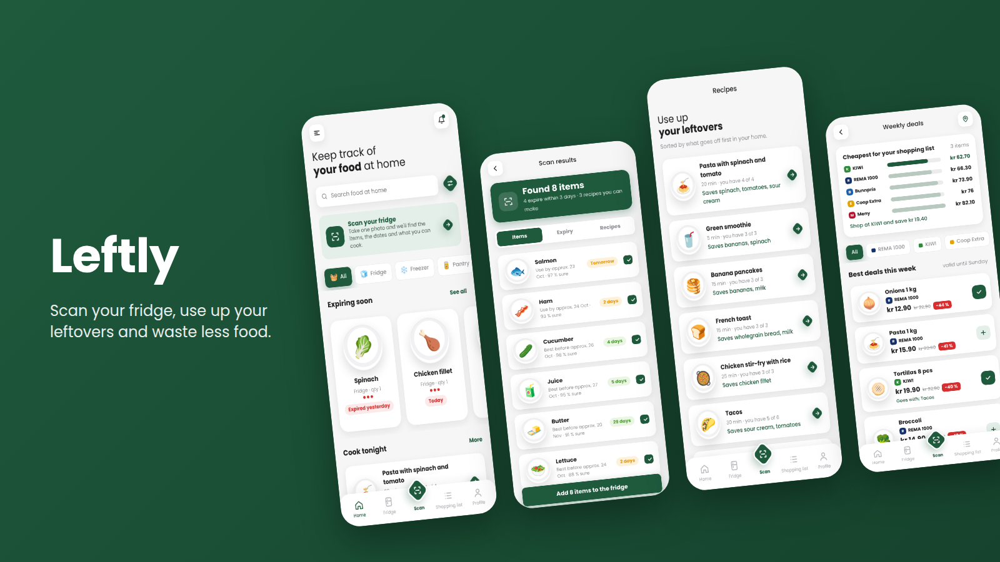
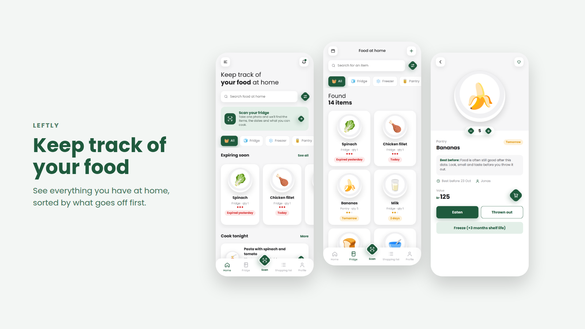
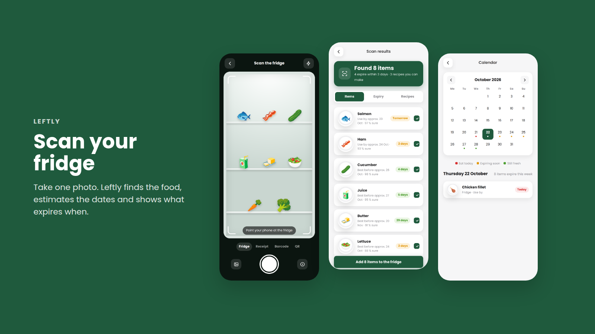
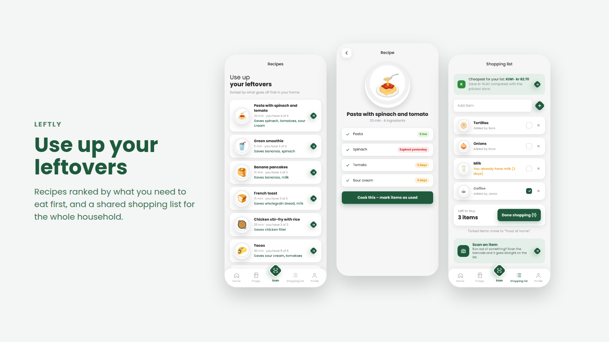
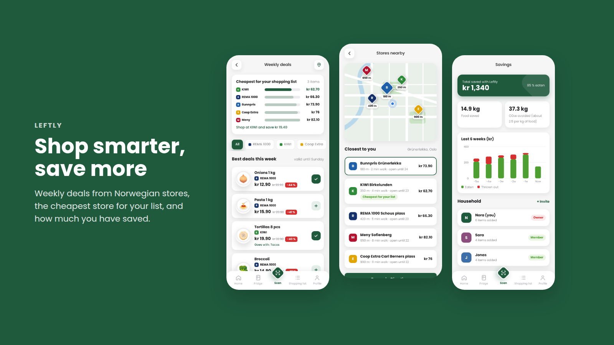

<h1 align="center">Leftly</h1>

<p align="center">
  <b>Scan your fridge, use up your leftovers and waste less food.</b>
</p>

<p align="center">
  
</p>

<p align="center">
  <a href="https://gloomyygl.github.io/leftly/"><b>Live demo</b></a> ·
  <a href="#features">Features</a> ·
  <a href="#getting-started">Getting started</a>
</p>

<p align="center"></p>
<p align="center"></p>
<p align="center"></p>
<p align="center"></p>

---

## Description

**Leftly** is a clickable app prototype that helps households reduce food waste.

About a third of all food is thrown away, often because we forget what we have at home or misunderstand the date on the package. Leftly keeps track of the food in your fridge, freezer and pantry, reminds you before it goes off, and suggests recipes that use up what is about to expire. The whole household shares one list, and you can see how much money and food you have saved.

The project was made as a group assignment (*Arbeidskrav 3 – Prototyping*) on the theme of food waste. It is based on our own mind map, wireframes and flowchart, and was designed in Figma before being built as a working web prototype.

## Features

- **Scan your fridge** – take one photo and the app finds the items, estimates the dates and sorts them by expiry
- **Scan receipts, barcodes and QR codes** – add food quickly after shopping
- **Food at home** – everything you have, sorted by what goes off first, with search and filters
- **Recipes from leftovers** – suggestions ranked by what you need to use up first
- **Shared shopping list** – warns you if you already have an item at home
- **Weekly deals** – compares Norwegian stores (REMA 1000, KIWI, Coop Extra, Meny, Bunnpris) and shows the cheapest one for your list
- **Stores nearby** – map with distance, opening hours and price for your list
- **Reminders and push notifications** – before food expires, with links to matching recipes
- **Calendar** – see which day each item expires
- **Savings** – money saved, kilos of food rescued and CO₂ avoided, per week
- **Household** – invite housemates with a QR code
- **Tips, discount codes, settings and feedback**

## How it works

1. **Log in** and land on the home screen with the food that expires soon.
2. **Scan** your fridge or receipt. Leftly finds the items and estimates the dates.
3. **Get reminders** before something goes off, with recipes that use it.
4. **Cook, eat or freeze** the food and mark it as used. Your savings go up.
5. **Shop smarter** with a shared list and the cheapest store for this week.

## Built with

- **HTML** – structure of all the screens
- **CSS** – design, layout and animations (font: [Poppins](https://fonts.google.com/specimen/Poppins))
- **JavaScript** – all the app logic, with no frameworks or libraries
- **Figma** – design and prototyping

Data is saved in the browser with `localStorage`, so your changes stay after a refresh. Scanning, prices and stores are simulated, since this is a prototype.

## Project structure

```
leftly/
├── index.html        # All screens of the app
├── css/
│   └── style.css     # Design and layout
├── js/
│   └── app.js        # App logic: navigation, data, scanning, recipes, deals
├── images/           # Pictures used in this README
├── LICENSE
└── README.md
```

## Getting started

No installation is needed.

1. Download or clone the repository:
   ```bash
   git clone https://github.com/gloomyygl/leftly.git
   ```
2. Open `index.html` in your browser.

The app is designed for mobile screens, but also works on a computer. Tip: you can drag the sideways rows with the mouse, or scroll them while holding Shift.

## Future ideas

- Real image recognition for the fridge scan
- Live prices from the stores, for example through the Kassalapp API
- User accounts and real syncing between household members
- Native app for iPhone and Android

## License

This project is licensed under the [MIT License](LICENSE).
